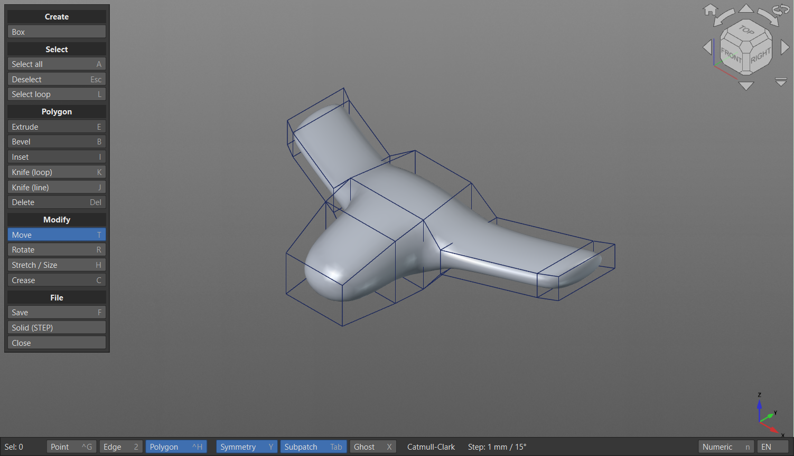
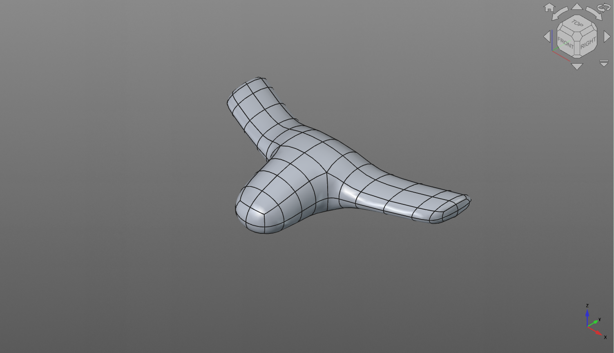
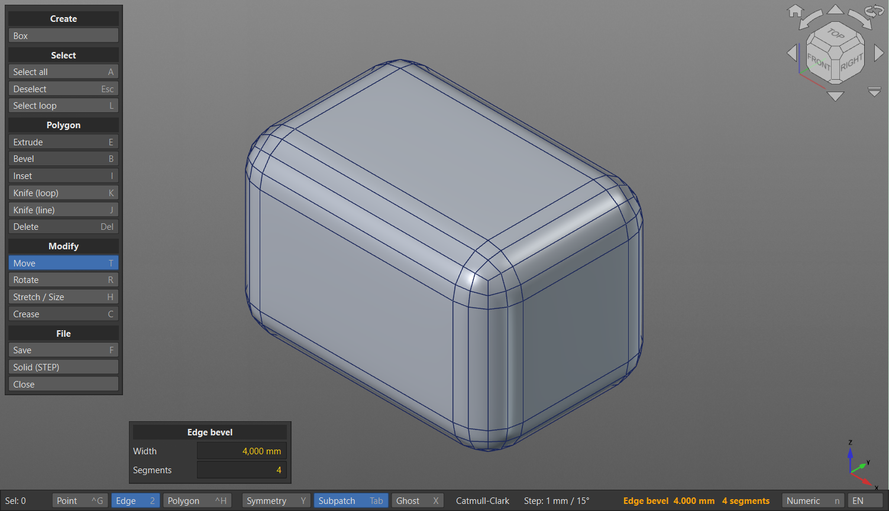
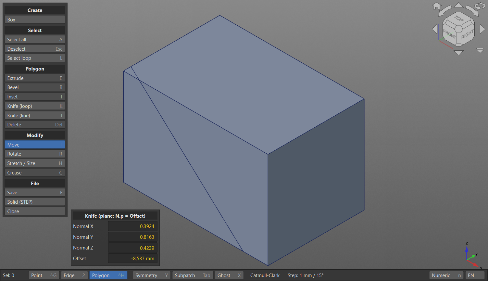
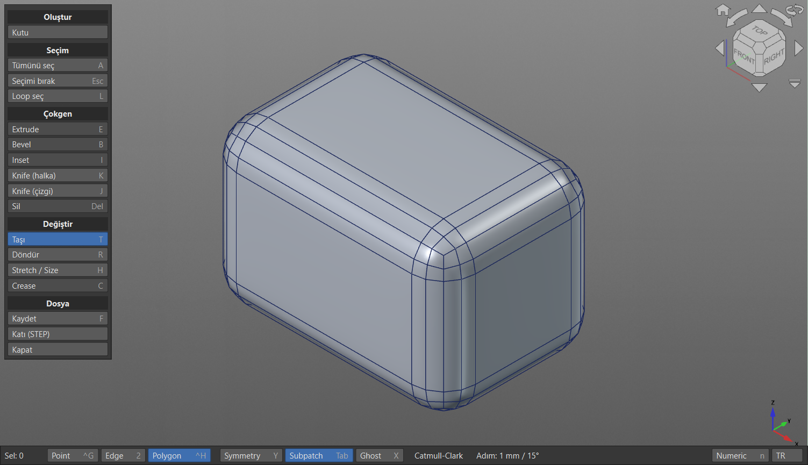

# SubD Modeler for FreeCAD

LightWave / Blender-style **subdivision surface (SubD) modeling inside FreeCAD's 3D view** — and a
**real B-rep solid** at the end that exports to STEP and works with Part / PartDesign.

You model a low-poly control cage with polygon tools (extrude, bevel, knife, loop cut...) and see the smooth
Catmull-Clark surface live. Everything has exact numeric input, so it stays a CAD tool: after every operation a
small panel in the viewport shows its values — type a number, press Enter, and the operation is redone with it.

> **Status:** early version (0.2.0, see the [changelog](CHANGELOG.md)). It works and is fun to use, but expect
> rough edges. Feedback and bug reports are very welcome.

## Is the result a mesh or a B-rep?

**A B-rep.** The modeler stores the cage in a `SubD` document object (its Catmull-Clark surface is shown as a
mesh while you work). **Solid (STEP)** turns it into a parametric `Part` solid made of bicubic B-spline faces:

- after one Catmull-Clark step the cage is all quads; every quad becomes one untrimmed B-spline patch
  (9 x 9 interpolated points by default),
- neighbouring patches share their boundary curves exactly, so the faces sew into a closed, valid solid,
- the solid is linked to the `SubD` object and updates when you edit the cage,
- creased edges stay sharp, so a fully creased 20 mm cube becomes exactly 20 x 20 x 20 mm (8000 mm³).

On a 95 mm test model the B-rep deviates at most ~0.02 mm from the subdivision surface. Evaluating the exact
Catmull-Clark limit surface is on the roadmap.

## Features

**Cage modeling (in the 3D view)**
- Point / edge / polygon selection, box select, loop select, ghost mode (see and select hidden elements)
- Extrude faces or open edges (edge mode: the surface continues outward), with segments (mouse wheel) and an
  X / Y / Z axis lock in the panel or with the X / Y / Z keys while dragging (no axis = along the normal)
- Bevel / Smooth Shift and Inset (mouse, or exact Inset / Shift values)
- **Edge bevel** (LightWave Rounder / Blender Ctrl+B): width + segments (mouse wheel), true circular profile,
  clean all-quad corners where three bevelled edges meet, straight 45° miters on edge loops
- **Knife (loop)**: loop cut that slides along the ring, exact position in % or mm
- **Knife (line)**: LightWave knife — draw a line and the model is cut **live** by the plane through it;
  then set the plane exactly (normal + offset)
- Crease (sharp or semi-sharp edges) — makes the surface hit exact dimensions
- Copy / cut / paste polygons (with their creases): paste in place into the same cage, into another SubD
  object, or as a new object (e.g. copy the neck of a bottle to start its cap)
- **From face** (drop-down: Face / Edge / Point), from a Part / PartDesign object (in object mode FreeCAD's own
  selection works):
  - *Face*: select faces (or closed flat edge loops) and turn them into one cage: four-sided faces (flat or
    curved: cylinders, B-splines...) become quad grids, flat faces with one or two boundaries become fans / quad
    strips, flat faces with several holes get a quad ring around each hole and a quad-dominant fill between
    them, neighbouring faces are welded along their shared edges, sharp joins and corners stay creased. With
    *Exact Edge* the cage is solved so the SubD surface passes through all sample points (about 0.08 mm on a
    4 mm thick filleted box)
  - *Edge*: each chain of selected edges becomes one polygon (flat or not, e.g. a mating line). Edges whose ends
    meet (within 0.01 mm, also from different objects) form one chain; an open chain is closed with a straight
    edge; separate chains give separate polygons. *Arc Segments* / *Max Length* set the sampling.
  - *Point*: the selected points become one polygon, in the order they were picked.
- **Make polygon** (P, LightWave Make Polygon / Blender F): a polygon from 3 or more selected points, a closed
  edge loop (fills a hole), or two edges / an open chain (bridges their ends); faces its neighbours
- **Snap** (bottom bar): free moves (G, the gizmo's centre cube) snap the point nearest to the cursor to the
  vertices and edges of visible Part / PartDesign shapes
- **Hole**: a round hole in the middle of the selected faces (one, two, four... in one flat patch); the patch is
  re-meshed around it automatically (quads where the counts match), with radius, segments and a support loop
- **Bridge** (Blender Bridge Edge Loops): connects two open edge loops / chains, or two face regions (their
  faces are removed), with number of cuts, twist, smoothness (tangent to the surfaces) and profile factor
- Mirror X / Y / Z (LightWave Mirror): mirrors the selected polygons (or the whole cage) across a world axis
  plane (exact center in the panel) and welds the points on the plane, so a half model becomes one piece
- LightWave-style **Create / Modify** tabs in the FreeCAD toolbar choose which tool menu the viewport shows
- X symmetry for every tool
- Move / rotate / stretch / size gizmo (ported from FC YBT Raytracer), Ctrl = mm / degree steps
- Exact numeric input for every operation, plus selection center / size in mm

**Object mode (O)**
- Work with several SubD objects: click / Shift+click / box select them (or select them in the tree)
- Move and rotate with the gizmo (stored in FreeCAD's standard `Placement`), stretch / size the cage
- Exact position, rotation and size in the viewport panel
- Shell (Modify): whole object or selected polygons, inside / outside / centered, detail filter for a smooth inner side, fill / sharp / flat rims
- SubD options: edit / final level, open edge rule, smooth triangles, zebra stripes; solid precision presets and G0 / G1 / G2 continuity (regular patches exported exactly)
- New box with a Box panel (width / depth / height and X / Y / Z segments, rebuilt as you type), new cylinder or all-quad topo cylinder (diameter / height / segments), duplicate (D), mirror across X / Y / Z, delete, solids for all selected objects
- O (or Tab) on a selected object edits its cage; the other objects stay visible as reference

**CAD side**
- The cage is saved in the document (`SubD` object), auto-saved every 20 s
- Parametric B-rep solid (`SubD to solid`), STEP export, booleans, PartDesign
- Shows both the cage size and the real surface size
- **Rail Pipe / Rail Groove** (toolbar, PartDesign): the exact B-rep counterpart of Rail bridge as a step in a
  PartDesign Body. Select one or two flat faces or closed sketches of the Body (a sketch: click its edge or pick it in the
  tree) and press Rail Pipe (adds) or Rail Groove (cuts): the start profile is swept along a guide curve to the
  second profile, or to a free end; in an empty Body the pipe is the first solid. The
  curve leaves (and enters) the faces perpendicular, passes through *GuidePoints* and follows the same rules as
  the modeler's guide (*Tension*, no bulge on uneven spacing); *EndScale* sizes a free end, *Reversed* flips
  the start direction. Double-click the feature to edit the guide on screen: click a yellow point and move it with
  the modeler's Move gizmo (arrows: along X / Y / Z, squares: in a plane, cube: in the screen plane) or drag
  the point itself (the white end points belong to the profiles); click the curve to pick a span and *Add
  point* puts a point exactly there; delete points, *Move neighbors* makes the guide follow like a cable
  (as in the modeler); the task panel also has the selected point's X / Y / Z, *Tension*, *End scale* and
  *Reversed*. OK keeps the changes as one undo step, Cancel reverts them. The feature recomputes like any
  PartDesign feature and later steps (fillets, pockets) build on it.

## Installation

Requires **FreeCAD 1.0 or newer** (developed on 26.3). No extra Python packages — only `numpy`, which ships
with FreeCAD.

**Addon Manager (custom repository)**
1. *Tools → Addon manager → ⚙ (settings) → Custom repositories*, add
   `https://github.com/sedatkrn/FcSubDModelerWB` with branch `main`.
2. Find **SubD Modeler** in the list, install, restart FreeCAD.

**Manual**
Clone or unzip this repository into FreeCAD's user `Mod` folder and restart FreeCAD:
- Windows: `%APPDATA%\FreeCAD\<version>\Mod\FcSubDModelerWB`
- Linux: `~/.local/share/FreeCAD/<version>/Mod/FcSubDModelerWB` (older versions: `~/.FreeCAD/Mod`)
- macOS: `~/Library/Application Support/FreeCAD/<version>/Mod/FcSubDModelerWB`

## Usage

Switch to the **SubD Modeler** workbench and press **SubD Modeler** (or run `macros/SubDModeler.FCMacro` from
any workbench). With one `SubD` object selected its cage is opened for editing; if the document already has
SubD objects and none is selected you start in object mode; in an empty document you start with a box.
**O** switches between object mode and editing the selected object (**Tab** toggles the SubPatch preview, as
in LightWave). **Close** writes the cage back to the
document; save the document as usual (Ctrl+S).

| Key | Action | Key | Action |
|---|---|---|---|
| O | object mode / edit the selected object | D | duplicate (object mode) |
| 1 / 2 / 3 | point / edge / polygon mode | Tab / S | SubPatch preview on/off |
| Click, Shift+click | select, add/remove | Drag | box select (Shift add, Ctrl remove) |
| A | select all | L | loop from the selection (edges, points, two faces), or under the cursor |
| E | extrude (faces / open edges, wheel = segments) | B | bevel (polygon mode) / edge bevel (edge mode) |
| I | inset | C | crease / uncrease selected edges |
| K | loop cut + slide (stays on) | J | line knife, live plane cut (stays on) |
| T / R / H | move / rotate / stretch-size gizmo | G | free move with the mouse |
| Y | X symmetry | X | ghost mode |
| Del | delete faces | Ctrl+Z | undo |
| P | make polygon from selected points / edges | | |
| Ctrl+C / Ctrl+X | copy / cut polygons | Ctrl+V | paste in place (object mode: as a new SubD object) |
| F | save to the document | N | Options panel |
| Ctrl (while dragging) | mm / degree steps | Shift (while dragging) | fine control |
| Esc / right click | cancel the running tool / turn the knife off | Mouse wheel (edge bevel) | segments |

## Language

The interface is English by default and **Turkish** is built in. The **EN / TR** button at the right end of the
bottom bar switches it (the modeler reopens with the same model). The setting is stored in
`Preferences/Mod/SubDModeler/Language` (`auto` follows FreeCAD's language).

## Roadmap

- Exact Catmull-Clark limit surface for the B-rep (Stam evaluation)
- Edge slide, more selection tools (face strips, grow / shrink)
- Export / import of the raw cage with creases (OBJ / USD) for Blender round-trips
- Odd segment counts for all-quad edge-bevel corners
- From face: curved faces that are not four-sided
- Rail Pipe: scale per guide point, sketches with several profiles (holes)

## License

MIT — see [LICENSE](LICENSE). Code comments are mostly in Turkish (the author's language); the user
interface and documentation are in English.

---

### Türkçe

FreeCAD için LightWave / Blender tarzı SubD (alt bölümlemeli yüzey) modelleyici: 3B görünümün içinde kafes
modelleme ve sonunda STEP'e aktarılabilen gerçek bir B-rep katı. Arayüz dili alt çubuktaki **EN / TR**
düğmesiyle Türkçeye çevrilebilir. Kurulum ve kullanım yukarıdaki İngilizce bölümle aynıdır.
